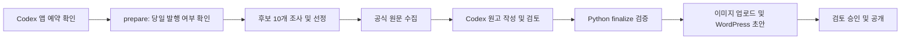

# Codex + Python IT 블로그 자동화

Codex가 IT 주제를 조사하고 한국어 분석 원고를 작성·검토하면, Python이 원고와 이미지 정보를 검사한 뒤 WordPress.com에 저장하고 공개하는 프로젝트입니다.

단순 뉴스 재가공보다 **새로운 기술이 기존 기술과 어떻게 다르고, 일반 사용자에게 무엇이 달라지는지** 설명하는 글을 목표로 합니다. 별도 유료 AI API는 연결하지 않습니다. WordPress API는 발행과 미디어 업로드에 사용합니다.

## 주요 기능

- 인터넷에서 주제 후보 최소 10개를 조사하고 하나를 선정
- 최근 글과 분야·제품·질문이 겹치는지 확인하고 분야 및 A~J 글 유형 순환
- 공식 원문·날짜·주장별 근거 인용 확인
- 성능 비교표, 사용 조건, 제조사 주장과 작성자 계산 구분
- 이용 권한이 확인된 주제 이미지와 대표 이미지 썸네일
- 제목3 볼드 소제목, 넉넉한 문단 여백, 본문 폭에 맞춘 이미지
- 표 헤더와 홀수 본문 행 배경색 구분
- 초안 → 검토 승인 → 공개 발행, 원고 해시와 상태 기록으로 중복 방지
- 매일 한국 시간 하루 최대 1편 자동 발행 및 별도 수동 추가 발행

## 작동 방식



| 작업 | 담당 |
|---|---|
| 주제 조사·분석·한국어 원고 작성·내용 검토 | Codex |
| 구조·인용 일치·이미지 권리 기록·원고 해시 검사 | Python |
| 이미지 및 초안 저장·공개 요청·결과 확인 | Python → WordPress.com API |
| 실행 시점 관리 | Codex 앱 자동화 |

Python은 문장의 사실성을 독립적으로 판정하는 AI가 아닙니다. 인용 일치는 원문에 그 문구가 있는지 확인하며, 해석이 정확한지는 Codex 또는 운영자가 검토해야 합니다.

## 시작하기

Python 3.9 이상이 필요하며 새 환경에는 3.11 이상을 권장합니다. 현재 운영은 macOS에서 확인했습니다. 파일 잠금에 `fcntl`을 사용하므로 기본 Windows 환경은 지원하지 않습니다. Linux에서 Python 부분은 실행할 수 있지만 전체 자동 운영은 별도 확인이 필요합니다.

```bash
python3 -m venv .venv
.venv/bin/python -m pip install -r requirements.txt
cp .env.example .env
```

`.env`에 WordPress OAuth 앱의 Client ID와 Client Secret을 입력하고 대상 사이트를 확인하세요. 이 배포본의 기본 사이트는 실제 개발에 사용한 공개 블로그 `syeob.wordpress.com`입니다. 다른 사이트로 사용하려면 [설치 설명서](docs/SETUP.md)의 두 SITE 상수를 먼저 수정해야 합니다.

```bash
.venv/bin/python blog.py auth
.venv/bin/python blog.py doctor
.venv/bin/python blog.py categories
.venv/bin/python -m unittest discover -s tests
```

원고 파일 없이 발행 명령만 실행하면 새 글이 작성되지 않습니다. 아래 문서에서 Codex 작성 절차 또는 수동 발행 절차를 이어가세요.

## 사용 설명서

| 문서 | 내용 |
|---|---|
| [설치 및 인증](docs/SETUP.md) | 환경 설정, 대상 사이트 변경, OAuth, 카테고리 |
| [Codex로 원고 작성](docs/CODEX.md) | 자동 운영 등록, 조사·작성·검토, 추가 글 요청 예시 |
| [VS Code 및 CLI 실행](docs/CLI.md) | 원고 검사, 미리보기, 초안 저장, 승인, 공개·예약 |
| [원고 및 파일 규격](docs/CONTENT.md) | JSON 형식, 출처, 근거, 이미지, 검토 파일 |
| [운영 및 오류 복구](docs/OPERATIONS.md) | 실행 조건, 중복 방지, 인증 오류, 복구, 테스트 |
| [GitHub에 올리는 방법](docs/GITHUB.md) | 포함·제외 파일, 업로드 절차, 라이선스 |
| [매일 운영 프롬프트](prompts/daily-automation.md) | Codex 앱에 적용할 프롬프트 예시 |
| [주제 선정 기준](it_blog_topic_prompt.txt) | 분야, 글 유형, 최신성, 평가 기준 |

## 파일 구성

```text
blog.py                    수동 CLI
app_runner.py              Codex 앱용 prepare / finalize
blog_core.py               검증, WordPress API, 상태, 이미지, 발행
automation_guard.py        날짜·요일·출처 수 정책 검사
automation-policy.json     로컬 발행 정책 (앱 예약을 설치하지 않음)
news_sources.py            공식 RSS와 원문 수집
post_layout.py             WordPress용 본문 스타일
article_writer.py          검증된 근거 패킷을 원고로 조립
run_scheduled.py           공용 작성 보조 함수 및 예전 CLI 실험 코드
wordpress_draft_test.py    OAuth 보조 코드와 연결 시험
articles/                  역사적 테스트 예시 및 로컬 원고
examples/                  작성 형식을 안내하는 미완성 예시
tests/                     API를 모의한 검증 테스트
```

`run_scheduled.py`의 독립 CLI 자동 작성 경로는 실험용입니다. 최신 10개 후보 조사 흐름과 동등하지 않으며 현재 권장 진입점은 `app_runner.py`와 `blog.py`입니다. `wordpress_draft_test.py`를 직접 실행하면 연결 확인용 초안을 만들 수 있으므로 평소 인증에는 `blog.py auth`를 사용하세요.

## 운영 조건과 공개 범위

매일 매시간 확인하고 그날 아직 글이 없으면 1편을 발행하는 운영을 전제로 합니다. 로컬 자동화에는 컴퓨터와 앱이 실행 가능한 상태로 켜져 있어야 합니다. 화면만 꺼진 상태와 시스템 잠자기는 다릅니다. 놓친 날짜를 다음 날 몰아서 발행하지 않습니다. [OpenAI 공식 자동화 문서](https://learn.chatgpt.com/docs/automations?surface=app)

GitHub에 코드를 올리는 것만으로 예약 작업이 생성되지 않습니다. 자동화와 인증은 각자의 컴퓨터에서 별도로 설정해야 합니다. GitHub Actions에서 AI 작성까지 자동 실행하는 구성은 제공하지 않습니다.

이 저장소 배포본에는 인증 정보, WordPress 토큰, 운영 상태, 실제 예약 설정, 개인 로그를 포함하지 않습니다. `articles`의 예시는 2026년 10월 기준 테스트 자료이며 현재 뉴스로 그대로 발행하지 마세요.

테스트 67개가 통과한 배포본입니다. 테스트는 실제 WordPress에 글을 쓰지 않습니다. 운영자의 소스 코드 공개 라이선스는 아직 지정하지 않았으며 외부 이미지의 라이선스와 별개입니다.
